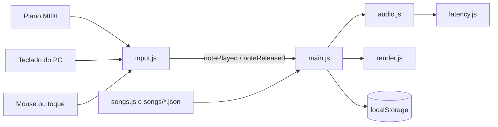

# Arquitetura

## Visão geral

O sistema é uma aplicação estática: HTML, CSS e JavaScript puros, sem framework, sem etapa de build e sem servidor de aplicação. Todo o processamento acontece no navegador.

Os scripts são carregados por `<script>` em ordem de dependência, e todos se registram em um único objeto global, `window.PianoHero`:

```
latency.js → audio.js → notes.js → songs.js → render.js → input.js → main.js
```

## Fluxo de dados



A entrada segue em sentido único. O `input.js` só emite eventos no `window`, e o `main.js` é quem os escuta e decide o que fazer. Assim, o jogo não precisa saber de onde a nota veio, e uma nova fonte de entrada só precisa emitir os mesmos eventos.

## Módulos

| Arquivo | Responsabilidade |
|---|---|
| `input.js` | Unifica MIDI, teclado e ponteiro nos eventos `notePlayed` e `noteReleased` |
| `audio.js` | Carrega as amostras, toca e abafa as notas, metrônomo e som de fallback |
| `notes.js` | Conversão entre MIDI e nome de nota, faixa do teclado e dificuldades do modo livre |
| `songs.js` | Músicas embutidas e carregamento das músicas em `songs/*.json` |
| `render.js` | Desenho em Canvas 2D das notas, do teclado e dos efeitos |
| `main.js` | Estado do jogo, loop principal, pontuação, menus, progresso e relatórios |
| `latency.js` | Instrumentação de latência e exportação de amostras |

## Camada de entrada

| Fonte | Tratamento |
|---|---|
| MIDI | `requestMIDIAccess` e leitura do status byte de note-on e note-off; descarta note-on duplicado quando o piano aparece como duas portas |
| Teclado | Mapa fixo de teclas para notas, com proteção contra repetição automática |
| Ponteiro | Rastreado por `pointerId`, o que permite vários dedos |

Notas MIDI fora da faixa do teclado desenhado são reposicionadas por `fold()`, em vez de descartadas.

## Tempo musical

**Ticks inteiros.** As durações são guardadas em ticks inteiros, com 480 ticks por semínima, como em arquivos MIDI. A conversão para segundos acontece uma vez, ao montar a linha do tempo. Isso evita o acúmulo de erro de ponto flutuante em músicas longas.

**Dois deltas por quadro.** O loop usa `requestAnimationFrame` e calcula dois intervalos:

- `dt`, limitado a 0,05 s, anima efeitos visuais sem saltos;
- `rawDt`, sem limite, avança o relógio da música (`state.songTime`).

Assim, um quadro atrasado não faz o jogo perder tempo musical. `checkAutoMiss()` consegue passar por várias notas perdidas em um único salto.

**Modo espera.** O relógio é limitado ao tempo da nota pendente. A nota nunca expira porque o tempo não passa dela.

**Navegação.** Toda mudança de posição passa por `seekTo()`, que recalcula o cursor e as notas esperadas.

**Fonte única do esperado.** `state.targetMidis` indica as notas devidas no momento e serve à pontuação e ao desenho. Todo código que avança `state.cursor` precisa atualizá-lo junto.

## Áudio

O motor usa 25 amostras reais de piano, de Dó3 a Dó5, decodificadas com `decodeAudioData`. A nota sustenta enquanto a tecla está pressionada e termina com um decaimento exponencial, imitando o abafador.

| Situação | Som usado |
|---|---|
| Nota dentro de Dó3 a Dó5 | Amostra correspondente |
| Nota até 1 oitava além da amostra mais próxima | Amostra com `playbackRate` ajustado |
| Nota mais distante ou amostra não carregada | Oscilador sintetizado |

O piano tem um barramento de ganho separado do metrônomo, o que permite silenciar só o piano. O `audio.js` também retoma o `AudioContext` depois de interrupções, comuns no iOS.

## Renderização

O desenho usa Canvas 2D ajustado ao `devicePixelRatio`, limitado a 2 nos celulares. O comprimento de cada barra é proporcional à duração da nota. Enquanto um menu cobre a tela, o loop não atualiza nem desenha, para poupar processamento.

## Persistência

Os dados ficam em `localStorage`, na chave `pianoHeroProgress`. Nada é enviado a um servidor.

| Campo | Conteúdo |
|---|---|
| `best` | Melhor resultado por fase |
| `scores` | Ranking das 5 melhores tentativas por fase |
| `records` | Recordes de precisão e de velocidade por fase |
| `last` | Última tentativa por fase |
| `prefs` | Opções do jogador, incluindo o BPM de cada música |

## Medição de latência

O `latency.js` divide o tempo entre a entrada e o som em quatro etapas: entrada até o disparo do evento, evento até o tratamento, tratamento até o agendamento do áudio, e agendamento até a saída estimada. Ele usa `AudioContext.getOutputTimestamp()` para relacionar o relógio do Web Audio com `performance.now()`, e projeta o instante agendado a partir do quadro que está saindo no dispositivo, que já inclui a latência de saída (até 12/11/2026 o código somava `outputLatency` de novo e contava essa latência duas vezes; o CSV traz a coluna `metodo` = 2 nas medições corrigidas). O valor final é uma estimativa do navegador, não uma medição física do som.

## Degradação graciosa

| Falha | Comportamento |
|---|---|
| Sem dispositivo MIDI | Teclado e toque continuam funcionando |
| Amostra ainda não carregada | Oscilador sintetizado |
| Página aberta por `file://` | Aviso explícito para usar um servidor local |

## Decisões de projeto

| Decisão | Motivo | Custo |
|---|---|---|
| Sem framework e sem build | Publicação simples e nenhuma dependência | Organização depende de convenção e da ordem dos scripts |
| Sem servidor | Sem custo de hospedagem e dados ficam com o jogador | Sem contas, sem sincronização e sem dados de uso centralizados |
| Canvas em vez de DOM | Muitos elementos animados a cada quadro | Acessibilidade e testes de interface mais difíceis |
| Ticks inteiros | Precisão ao longo da música | Exige conversão ao montar a linha do tempo |
| Evento único de entrada | Desacopla o jogo da origem da nota | Nenhum relevante |

## Limitações técnicas

- Não há testes automatizados.
- O som é disparado no momento da entrada, sem agendamento antecipado.
- Web MIDI não está disponível no Safari e no iOS.
- O `main.js` concentra grande parte da lógica, com cerca de 2.200 linhas.
